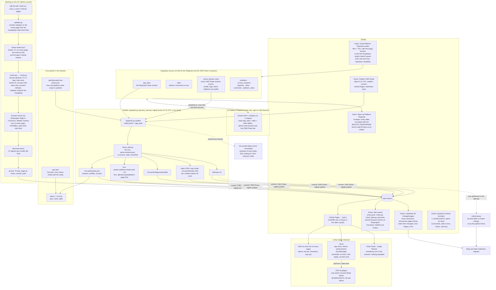

# How jsal.io works behind the pages

The site is static files on GitHub Pages; the only moving parts are one database (Supabase, for the team Playbook and the CMS Picker's answers), four GitHub Actions, and the checks that run before a push. This page is the map; the rules that govern each part are in `CLAUDE.md` and `.claude\rules\cms-picker-playbook.md` (outside the repo), and the CMS Picker's data rules in `cms-picker-maintenance.md`.

## Reading the map

- **Content flows one way out of Supabase.** Admins edit on the live Playbook; `playbook.py publish` reads the `picker` table and writes the CMS Picker's files; the Action commits them. Nobody edits `data.json`, the platform pages, the uploaded logos or the plain-HTML copy by hand. Structural changes to the Playbook (a new item, page type or guide) go through `playbook.py pull` → edit `private\playbook\defaults.json` → `push`.
- **Two keys, two trust levels.** The browser uses the public anon key with row-level security (members read, admins write). The publish and backup scripts use the service_role key, which lives only in John's terminal (`SUPABASE_SERVICE_ROLE_KEY`) and in the Action's secrets.
- **The quiz is code plus data.** `score.js` (questions, scoring, wording) and `quiz.json` (per-platform values the published answers don't carry) ship with the page; everything else the quiz says comes from `data.json`. The personas test pins the agreed results.
- **A change is described once.** The changelog is the record; an entry with a `data-short` leads its section in Updates on the home page, which `updates.py` writes between two marker comments in `index.html`. `check.py` fails when that block is out of date, so nobody edits it by hand.
- **Cache numbers, not a build.** There's no bundler. `bump-version.ps1` rewrites `?v=` so browsers fetch changed files; `check.py` fails a page whose numbers are out of step.
- **The Action is the full gate.** `check.py`, `check_data.py`, the personas and the browser checks (axe, phone widths, each tool's flow on Chromium, WebKit and Firefox) all run on every push; the PC runs the same before pushing, Firefox excepted (it won't start there).
- **Keep-awake reads the Supabase URL and anon key from the repository's Actions variables** (`SUPABASE_URL`, `SUPABASE_ANON_KEY`; the same public values `ic/app.js` carries). A new Supabase project means updating both.
- **Backups live in two places:** `playbook.py backup` on the PC (plain JSON in `private\backups`), and the Sunday Action's encrypted artifact on GitHub (90 days; `gh run download <run id> -n playbook-backup`, then `gpg --decrypt` with the passphrase John set as the `BACKUP_PASSPHRASE` secret). The repo is public and its artifacts are downloadable by any GitHub account, which is why the file is encrypted.
- **Nobody runs IndexNow by hand any more:** the nightly publish announces its pages and the push Action announces any page whose `index.html` changed.
- **Analytics are opt-in where the law asks.** Each page's head sets Consent Mode defaults; `nav.js` loads gtag.js only where analytics may run, and the home page footer reopens the choice.
