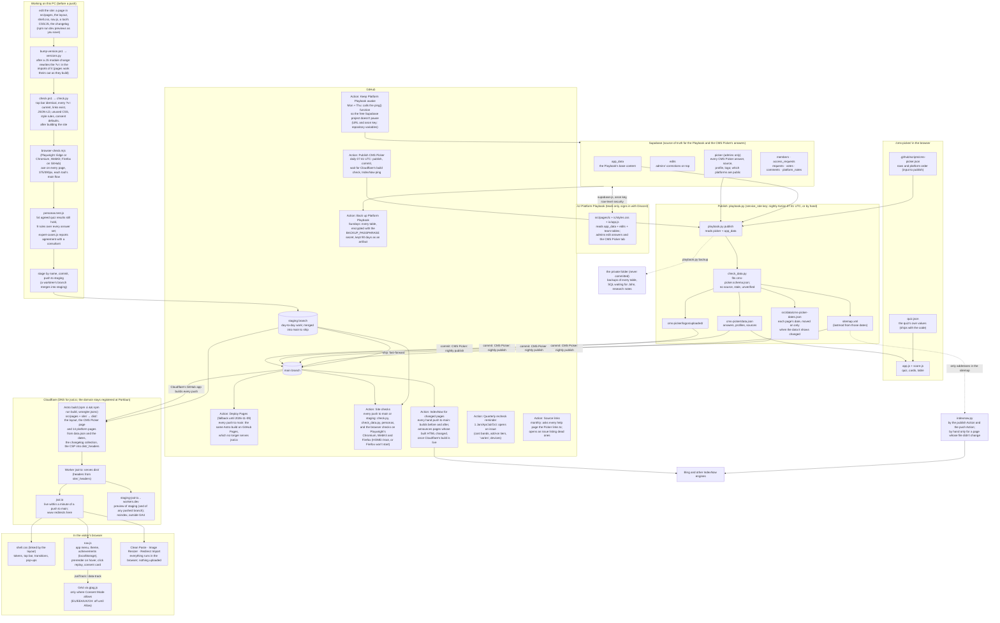

# How jsal.io works behind the pages

The site is static files on Cloudflare (a Worker with static assets only), built by Astro from GitHub on every push; the only moving parts are one database (Supabase, for the team Playbook and the CMS Picker's answers), eight GitHub Actions (one of them the GitHub Pages copy, a fallback until 2026-11-09), and the checks that run before a push. This page is the map; the rules that govern each part are in `CLAUDE.md` and `.claude\rules\cms-picker-playbook.md` (in the repo, never served), and the CMS Picker's data rules in `cms-picker-maintenance.md`.

## Reading the map

- **Content flows one way out of Supabase.** Admins edit on the live Playbook; `playbook.py publish` reads the `picker` table and writes `data.json`, the uploaded logos and each page's date; the Action commits them, and Cloudflare's build makes the CMS Picker page's plain-HTML copy (for crawlers that don't run JavaScript) and the 14 platform pages from them (`src/lib/cms-picker.mjs`). Nobody edits `data.json`, the uploaded logos or the dates by hand. Structural changes to the Playbook (a new item, page type or guide) go through `playbook.py pull` → edit `private\playbook\defaults.json` → `push`.
- **Two keys, two trust levels.** The browser uses the public anon key with row-level security (members read, admins write). The publish and backup scripts use the service_role key, which lives only in John's terminal (`SUPABASE_SERVICE_ROLE_KEY`) and in the Action's secrets.
- **The quiz is code plus data.** `score.js` (questions, scoring, wording) and `quiz.json` (per-platform values the published answers don't carry) ship with the page; everything else the quiz says comes from `data.json`. The personas test pins the agreed results; the expert cases (`expert-cases.js`) report, without ever failing, how often the quiz agrees with what an experienced consultant would pick.
- **A change is described once.** The changelog is a content collection (`src/content/changelog.json`, one entry per line, checked by the schema in `src/content.config.mjs`); the Changelog page and Updates on the home page both read it as they build, and an entry with a `short` leads its section in Updates. A bad entry (a date, a tag, HTML, the order) stops the build and names its line.
- **The project folder is the repository; `dist/` is what's served.** Astro builds the pages in `src/` with the files in `site/` (copied as they are) into `dist/`. `.github/` (workflows, build scripts, publish scripts, docs), the rules and `SETUP.md` sit beside them and never reach the site; `private/` is ignored. `wrangler.jsonc` builds the site and points Cloudflare at `dist/`, so nothing else is served; a push to `main` is live once Cloudflare's build check on the commit is green (it reports to GitHub as a check run).
- **Staging is a branch, not a second site.** Every push to `staging` updates its preview address and runs the Site checks, and touches nothing live: no deploy to jsal.io, no IndexNow, no GA4 (`nav.js` loads gtag.js only on jsal.io). Shipping fast-forwards `main` to `staging` in one push.
- **Cloudflare changes pages only if told to.** Its zone features that rewrite HTML (Email Address Obfuscation, Web Analytics' injected script) are off; served pages match the built files in `dist/` byte for byte, which is the check after any Cloudflare setting change.
- **Browsers keep the files that don't change for a year.** Cloudflare's default (`max-age=0, must-revalidate`) made every page ask again for each font, stylesheet and script before showing, so pages hung and drew their text in a fallback font first. `site/_headers` gives `.css`, `.js` and `fonts/` a year (safe because every CSS and JS reference carries its content hash, which `check.py` enforces; a font or the HEIC library that changes gets a new name) and `img/` a day; pages and JSON keep the default, so a deploy shows at once.
- **Cache numbers, worked out as the site builds.** Nothing is bundled: each app's CSS and JS ship as plain files. Every `?v=` is its file's content hash (8 hex characters of its SHA-256, line endings as LF so Windows and GitHub agree). The pages get theirs from the build (`v()` in `src/lib/v.mjs`, and `importmap()` for the apps' import maps; `quiz.json`'s is `data-quiz-v` on the CMS Picker's `app.js` tag), so they can't go stale; the apps' modules import each other with `?v=` too, which `bump-version.ps1` (`versions.py`) rewrites after a module changes. `check.py` fails any reference whose hash isn't the file's current one.
- **The Action is the full gate.** `check.py`, `check_data.py`, the personas and the browser checks (axe, phone widths, each tool's flow on Chromium, WebKit and Firefox) all run on every push; the PC runs the same before pushing. Firefox starts in neither place, so it stays on the real-device checklist.
- **Keep-awake reads the Supabase URL and anon key from the repository's Actions variables** (`SUPABASE_URL`, `SUPABASE_ANON_KEY`; the same public values `ic/app.js` carries). A new Supabase project means updating both.
- **Backups live in two places:** `playbook.py backup` on the PC (plain JSON in `private\backups`), and the Sunday Action's encrypted artifact on GitHub (90 days; `gh run download <run id> -n playbook-backup`, then `gpg --decrypt` with the passphrase John set as the `BACKUP_PASSPHRASE` secret). The repo is public and its artifacts are downloadable by any GitHub account, which is why the file is encrypted.
- **Source links are checked monthly.** `check_sources.py` (the "Source links" Action, 3rd of the month) fetches every unique address in `data.json`'s sources and `quiz.json`'s guides and free-plan pages, reports dead, blocked and moved pages; the addresses a site refused get a second pass in a real browser (`check_sources_browser.mjs`, Playwright's Chromium on the runner), and what's still refused is listed for a check by hand. An issue opens when either pass finds a dead page. Fixes go on the Playbook's CMS Picker tab, then a publish.
- **Security headers come from `site/_headers`:** HSTS (a year, no `includeSubDomains` while other subdomains aren't known to be HTTPS), `nosniff`, `X-Frame-Options: SAMEORIGIN`, `Cross-Origin-Opener-Policy: same-origin` (the Playbook's Discord sign-in is a full-page redirect, not a pop-up, so it isn't affected) and `Referrer-Policy`.
- **A content security policy, written from the pages.** `site/_headers` sends one on every response (between its `csp:start` and `csp:end` comments): scripts only from the site, gtag.js and the pinned Supabase script, plus each inline script by its SHA-256 hash (the early click holder, the theme and Consent Mode scripts, the apps' import maps, the 404's animation, the footer years, and the two fixed speculation rules `nav.js` adds); images, connections and the Playbook's Supabase and Discord hosts; no plug-ins, no framing by other sites, no forms posting elsewhere. Styles allow `'unsafe-inline'` (every page has inline styles). `.github/build/csp.mjs` writes the block into the built `dist/_headers` at the end of every build, from the built pages, so it can't fall behind an edited inline script (which the live site would otherwise block); `site/_headers` holds only the empty markers. Only the Image Resizer adds `'unsafe-eval'`, for its HEIC converter, which builds code as it runs. `'inline-speculation-rules'` can't be used: Chrome ignores it in a policy that lists hashes.
- **Nobody runs IndexNow by hand any more:** the nightly publish announces the pages whose dates it moved on, and the push Action builds the site before and after a push and announces every page whose built HTML changed (a page's own edit, the layout, the changelog).
- **Analytics are opt-in where the law asks.** Each page's head sets Consent Mode defaults; `nav.js` loads gtag.js only where analytics may run, and the home page footer reopens the choice.
